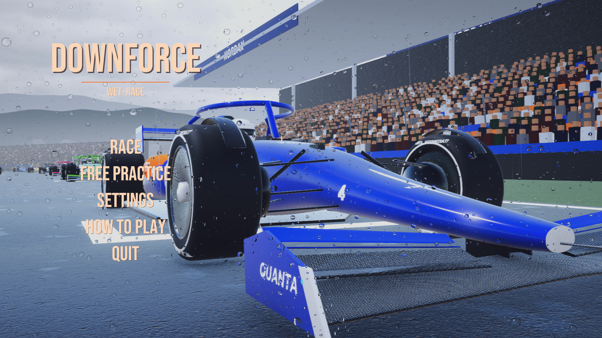

# Downforce

Made by Muhammad Irfan.

An open-wheel racing game made in Unity. Wet races at a 1:1 Interlagos (real layout and elevation) or the original classic track, from the cockpit against a full grid, with free practice and a T-cam.

## Demo
[Watch the playthrough](https://www.youtube.com/watch?v=3Vs1ufC0Vrs)

Play in the browser: [huznot.github.io/downforce-site](https://huznot.github.io/downforce-site/)

## Download and play
1. Download `Downforce.zip` from [Releases](https://github.com/huznot/downforce/releases)
2. Unzip it
3. Open the `Downforce` folder and run `Downforce.exe`

Controls: WASD or arrow keys, any gamepad, or mouse steering (Settings). C changes camera, R resets, F11 toggles fullscreen.

## Run from source
1. Install Unity 6000.2.12f1 and [Git LFS](https://git-lfs.com) (the race scene is stored with LFS)
2. Clone this repo, then add the folder in Unity Hub
3. Run **OWR > Build Circuit: Interlagos** once (it generates the Interlagos scene, about 2 minutes)
4. Open `Assets/_Game/Scenes/Interlagos.unity` (or `Race.unity` for the classic track) and press Play

Some trackside props use the free *Lowpoly Track Environment Free* pack by BEDRILL from the Unity Asset Store. It isn't included here; import it into `Assets/BEDRILL` to get them.

## Layout
| Path | What's in it |
| --- | --- |
| `Assets/_Game` | scenes, scripts, shaders, art and audio made for this game |
| `Assets/_Game/External` | CC0 textures (Poly Haven, ambientCG) and MIT-licensed WebXR hands |
| `Assets/Settings` | render pipeline settings |
| `Assets/WebGLTemplates` | the web page used for the browser build |
| `Tools` | build-time scripts (audio, trailer) |

## Credits
- Interlagos layout from [bacinger/f1-circuits](https://github.com/bacinger/f1-circuits) (MIT)
- Elevation from SRTM 30 m data via [OpenTopoData](https://www.opentopodata.org)
- Marshal and pit crew figure: "Worker" by Quaternius (CC0)
- Textures from Poly Haven and ambientCG (CC0), hands from WebXR input profiles (MIT)
- All teams, drivers and sponsors are invented

## License
MIT, see [LICENSE](LICENSE).
